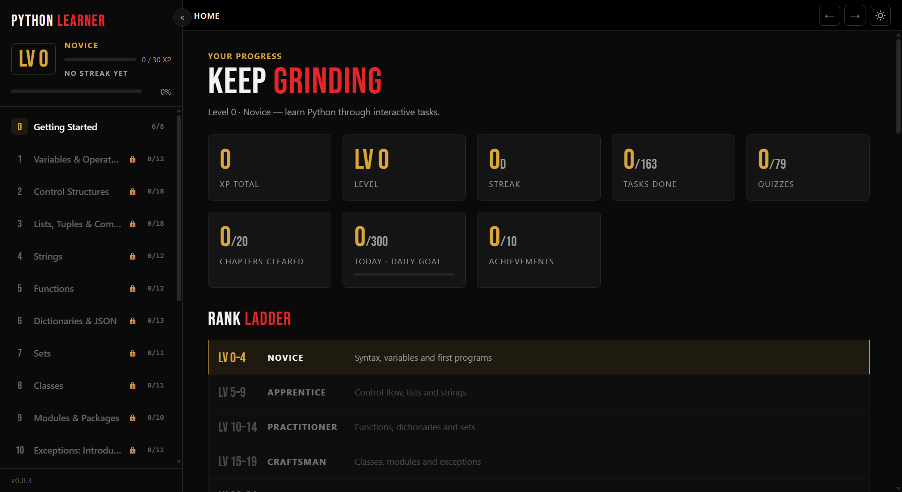

# Python Learner

Hab das für den Python-Unterricht gebaut: eine Desktop-App, die die
Schul-Notebooks als richtiges Lernprogramm aufzieht - Lessons, Quizzes und
Coding-Tasks in 20 Kapiteln, vom ersten `print` bis zu Generatoren und
File Processing. Code läuft lokal gegen echte Tests, Fortschritt und
Entwürfe werden automatisch gespeichert.



## Features

- XP, Level, Ränge, Streaks und Achievements (Boss-Tasks geben x1,5 XP)
- Kapitel-Locks: das nächste Kapitel geht erst auf, wenn 90% vom
  vorherigen fertig sind
- Aufgaben mit Auto-Check: Code schreiben, Check drücken, Tests laufen lokal
- Hints kosten ein bisschen XP, "Show solution" gibt's auch mit Copy und
  "Load into editor"
- "Similar solved example" bei den Tasks, gleiches Prinzip, andere
  Zahlen, kostet keine XP
- Dark mode default, Light mode geht auch
- "What's new"-Popup nach einem Update (einmal pro Version)

## Installation

Windows: den Installer aus dem Ordner `installer/` (oder aus den GitHub
Releases) laden, `PythonLearner-X-windows-Installer.exe` ausführen, fertig. Wer
nichts installieren will, nimmt das portable Zip: entpacken und
`Python Learner.exe` starten.

Mac (Apple Silicon): es gibt ein Build-Kit
(`PythonLearner-X-mac-buildkit.zip`), auspacken,
`Build Python Learner.command` doppelklicken, das baut eine echte
`.app` + `.dmg` auf dem Mac. Details stehen in `tools/mackit/BUILD-ON-MAC.md`.
Notes Hierzu: Mac ist Ungetestet, funktion ist nicht garantiert.

## Entwickeln

Braucht Python 3.12 und `pip install -r requirements.txt`
(WebView2-Runtime ist auf Windows 11 eh drauf).

- `Python Learner.bat` - sucht Python, installiert fehlende Pakete,
  öffnet das App-Fenster
- `run_dev.bat` - derselbe Kram im Browser auf http://127.0.0.1:8765,
  praktisch zum UI basteln

Der Fortschritt liegt in `%LOCALAPPDATA%\PythonLearner\progress.json`,
löschen heißt alles weg. Für Tests kann man mit `PYTHON_LEARNER_HOME` auf
einen anderen Ordner zeigen, dann geht der echte Stand nicht kaputt.

## Tests / Gates

Vor jedem Release laufen:

```
python tools\validate_content.py   # jede solution gegen ihre tests + starter-kompilierung
python tools\validate_lessons.py   # jeder code-block in lessons + task-examples standalone
python tools\test_gamification.py  # xp, locks, streaks
python tools\test_errors.py        # die friendly-error-texte
python tools\test_whatsnew.py      # whats-new popup logik
python tools\audit_examples.py     # stimmen beispiel-outputs in den instructions?
```

`validate_content.py` checkt auch die Struktur (unique ids, hints,
erklärungen lang genug, example-feld mit python-block wo nötig).

## Release bauen

```
tools\build_release.ps1 -Version 0.0.3 -UsbRoot E:\PyLearner
```

Baut den PyInstaller-Ordner, das portable Zip und den Inno-Installer
(`tools\installer.iss`), legt Checksummen bei und kopiert alles auf den
USB-Stick unter `Windows Releases\` + `MAC Releases\`. Das Mac-Build-Kit
kommt aus `tools\build_mac_bundle.ps1` bzw. `tools\mackit\`.

## Projektstruktur

```
app/
  main.py           pywebview-fenster, desktop-einstieg
  server.py         dev-server (ui + api auf 127.0.0.1:8765)
  api.py            alles was das ui per js-api aufruft
  checker.py        test-harness, wertet tasks aus
  runner.py         user-code im temp-dir als subprocess
  errors.py         tracebacks -> verständliche sätze
  gamification.py   xp, level, locks, achievements
  progress.py       progress.json lesen/schreiben/backup
  release_notes.py  "what's new"-texte pro version
  content/          20 kapitel als python-module + data/
  ui/               index.html, styles.css, app.js + vendor
tools/
  build_release.ps1   gates + windows + usb-copy
  build_windows.ps1   pyinstaller + zip + installer
  build_mac_bundle.ps1 / mackit/   mac build-kit
  installer.iss       inno setup script
  python_learner.spec pyinstaller spec
docs/screenshots/   die bilder hier oben
```

Pro Kapitel eine Datei `app/content/chNN_*.py` mit `CHAPTER = {...}` -
Items sind `lesson` (markdown body), `quiz` (options + answer) oder
`task` (instructions, starter, hints, solution, tests, example).

Aktuell 170 Tasks, 79 Quizzes, 29 Lessons. Jedes Kapitel hat warm-ups
vorne und eine boss-mission hinten.
